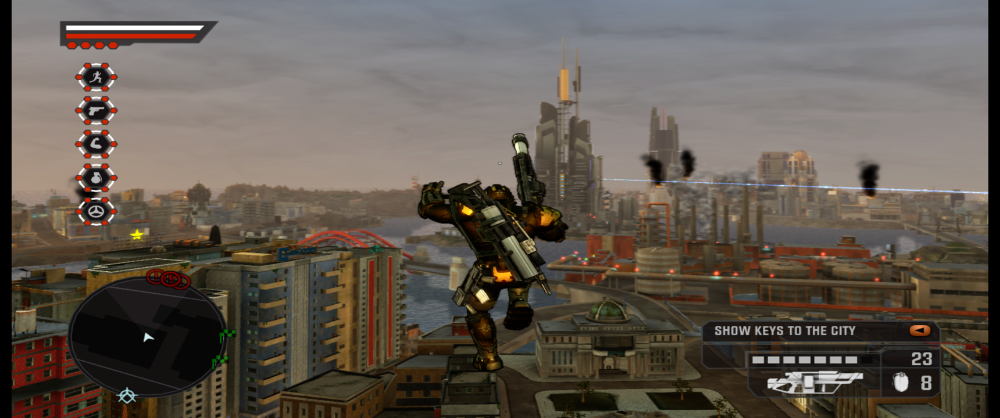
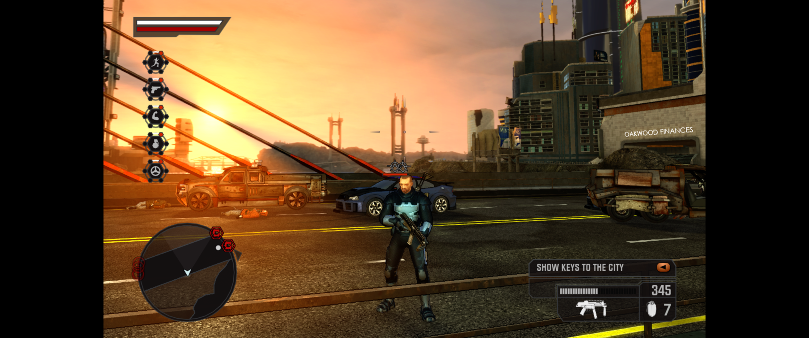
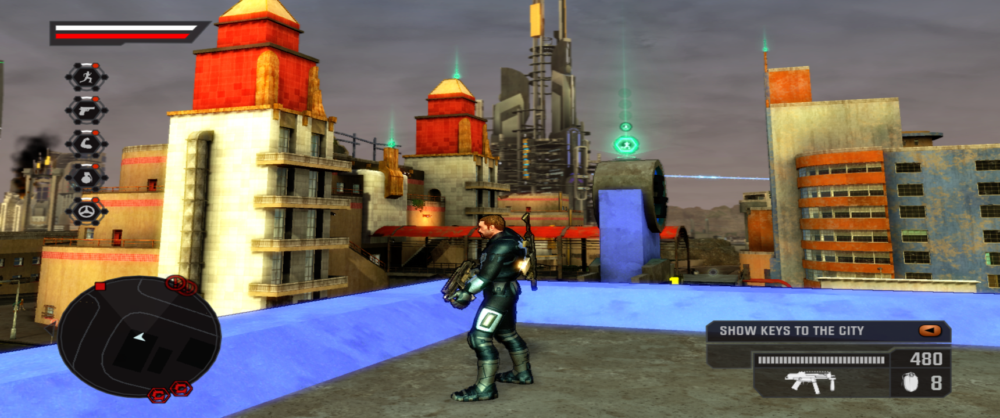
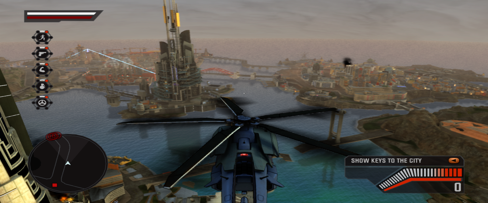

## Quick start: from your own disc to a running game

You need your own copy of the game. Nothing from the disc or the title update is in this repository or in the release
zips; the steps below turn your disc into the `assets` folder the recomp reads.

1. **Dump the disc** to an ISO with whatever you use for Xbox 360 discs (a PC DVD drive with 360-capable firmware, or a
   dump made on the console). Check it is the right build: after extraction `assets\default.xex` must have the SHA-256
   listed under *Hashes* below.
2. **Get Title Update 5** (the `xexp` container from Xbox Live; its SHA-256 is also listed below). TU5 is required: the
   recompiled code is generated from the patched executable, and the runtime mounts the extracted update as `update:`.
3. **Set it up in one go** (Python 3.8+, no extra packages). From the release folder or the repo root:
   ```
   python tools\setup_game.py --iso <game.iso> --tu <TU5 file> [--dlc <package> ...]
   ```
   This extracts the disc to `game\assets`, the update to `game\tu5`, puts `default.xexp` beside `default.xex`
   (codegen applies it from there), checks both against the hashes below, installs any DLC packages you pass, and
   writes `cd2_game.json` so the launcher knows the paths. Already-extracted folders are accepted in place of the
   ISO / update file and are used where they are. The individual steps are `tools\xdvdfs_extract.py`,
   `tools\stfs_extract.py` and `tools\dlc_install.py` if you prefer to run them yourself.
4. **Either use a release build or compile:**
   * *Release zip* (Windows x64, from this fork's GitHub Releases page): extract it anywhere, run the setup above
     from inside it, then
     ```
     .\tools\run_cd2.ps1
     ```
     The zip holds `crackdown2.exe`, the two rexglue SDK DLLs (built from the v0.10.0 source with the patches under
     `patches/rexglue-sdk/`, which the keyboard/mouse look and settings saving rely on), `tools\`, `docs\` and this
     README. No game data.
   * *Compile it yourself*: run the setup with `--dest .` (or point `--iso` at the folder you extracted into
     `assets\`), then follow *To build* / *Windows build* below. Codegen runs as the first build step and needs
     `assets\default.xex` and `assets\default.xexp`; a clean Windows build takes about five minutes plus codegen.
5. **DLC later**: `python tools\setup_game.py ... --dlc <package> [...]` or `tools\dlc_install.py` directly (see *DLC*).
6. **Play**: the intro videos (CRI Sofdec) play when the machine has an audio output device; without one (a headless
   box, or a remote session without audio redirection) the player stalls and the screen stays black until you press
   START, which is Enter on the keyboard; the launcher turns keyboard/mouse gamepad emulation on by default (`-NoKeyboard` to disable it).
   Options > Display holds the graphics, input and (with `-Cheats`) cheat rows; F5 opens the overlay with
   a developer-console prompt; F4 rebinds keys. See *Controls* and *Performance* for the defaults the launcher applies.

## Screenshots

RTX 3050 Ti laptop on a 3440x1440 monitor, default settings (2x MSAA, 16x anisotropic filtering, no post AA), FPS
counter off.

| ASPECT RATIO = AUTO (21:9 on this monitor) | ASPECT RATIO = 16:9 (original framing, side bars) |
| --- | --- |
|  |  |





The wider aspect is real field of view, not stretching: the game derives its projection and HUD layout from the video
mode the recomp reports (see *Menus and settings*).

## Requirements:
- [Rexglue SDK 0.10.0](https://github.com/rexglue/rexglue-sdk)
- CMake
- Ninja
- Clang++/LLVM
- Crackdown 2 game disc
- Crackdown 2 Title Update 5

# Hashes
- Default.xex
 ```SHA256: 8959C449E382661D29B8EA479C685F506CD5BD3ECA40B3D73A51CC10F281069F```
- Crackdown 2 Title Update 5 xexp
 ```SHA256: A5E49FC1FF7F6F65E6F95A7B5C4B9392BB9E38674D1237AC0E2F0149D05929D7```

DLC packages (optional, see *DLC*). These are the marketplace `LIVE` containers for title `4D5308BC`; the file name is the
package's content ID, the hash is of the container as downloaded:

| Pack | Package file name | Size | SHA-256 |
|---|---|---|---|
| Toy Box Pack | `856014F705032E789E4A6DBD2546F470B06ED71F4D` | 51,814,400 | `CF679BB4A061F9C7319EB1D5E4297888A1AB52B73436DC0B08C47F0528C774FD` |
| Deluge Pack | `BD0C27EFE61BEE10F176F3A624F8A851224A89694D` | 174,309,376 | `A1064677C4A756C4C82DC79CDA60622F15A19E14393AE661E1CE4B9CCC6AD480` |
| Pre-Order Armor | `ACE4E65BC7BA561F3A27C1A5390B5904CB6C73EB4D` | 57,344 | `1EE257B70EC9B61BF8B7FAC47579D9982A7BCDD1D47080260ECBD1F4CD09E372` |

The "Crackdown 2 (Addon)" set that circulates alongside them (27 small `LIVE` files under `4D5308BC/00009000/`) is
avatar clothing (content type `00009000`: t-shirts, caps, the Agency SUV avatar prop and so on). It is not game content,
the game never enumerates it, and `dlc_install.py` is not meant for it.

## To build:
 - Compile and install the rexglue SDK
 - Extract game disc and latest title update into the assets folder. (Including its xexp file)
 - Run the codegen by using the rexglue binary in the rexglue sdk install folder, with the jump table limit raised
   (rexglue ignores `max_jump_table_entries` in the manifest; the game has a 518-entry switch table in
   `Anim_cProfileDataHand2HandFull_HandleAttributeData` and the default limit of 512 truncates it, which traps on load).
   The CMake presets export `REX_MAX_JUMP_TABLE_ENTRIES=519`, and with SDK 0.10.0 codegen runs as part of the build, so
   building through a preset is enough. To run it by hand:
   ```rexglue codegen crackdown2_manifest.toml --max_jump_table_entries=519``` (0.10.0; on 0.9.0 the CLI rejects the
   flag, use the environment variable instead).
 - Windows: ```cmake --preset win-amd64-relwithdebinfo; cmake --build --preset win-amd64-relwithdebinfo``` in the main folder
   (see the Windows section below for prerequisites and the run script)
 - Linux (clang 20 and the SDK install prefix on hand):
   ```cmake --preset linux-amd64-relwithdebinfo -DCMAKE_PREFIX_PATH=<sdk-prefix> -DCMAKE_EXE_LINKER_FLAGS=-fuse-ld=lld```
   then ```cmake --build --preset linux-amd64-relwithdebinfo```
 - Run with the GPU plugin enabled (it is off by default) and the extracted title update mounted as `update:`:
   ```crackdown2 --game_data_root=<assets> --update_data_root=<extracted TU folder> --gpu_plugin=xenos```
   On Linux put the SDK `lib` folder on `LD_LIBRARY_PATH`; the xenos plugin is staged next to the executable by CMake.

 # Status: In-game but not playable yet.

## Windows build

Prerequisites (all machines, including laptops/iGPU boxes):
 - [Rexglue SDK 0.10.0](https://github.com/rexglue/rexglue-sdk/releases/tag/v0.10.0) `rexglue-sdk-0.10.0-win-amd64.zip`, extracted anywhere (its `bin\rexglue.exe` and `lib\cmake` are what the build needs).
 - LLVM/Clang 20 or newer for Windows (official installer; `clang`/`clang++` on PATH), CMake 3.25+, Ninja, and Visual Studio 2022 Build Tools with the Windows 10/11 SDK (for the system headers and `link.exe`).
 - Python 3 for the extraction scripts in `tools/` (they are pure Python and work the same on Windows).

Steps (PowerShell, from the repo folder):
 1. Extract the disc and title update into `assets\` as described above, e.g.
    ```python tools\xdvdfs_extract.py <game.iso> assets``` and ```python tools\stfs_extract.py <TU5 file> assets```.
 2. Configure, pointing CMake at the SDK:
    ```cmake --preset win-amd64-relwithdebinfo -DCMAKE_PREFIX_PATH=<sdk-folder>```
 3. Build (codegen runs as the first build step; the preset already exports `REX_MAX_JUMP_TABLE_ENTRIES=519`):
    ```cmake --build --preset win-amd64-relwithdebinfo```
 4. Run: ```.\tools\run_cd2.ps1``` (add `-Update <extracted TU folder>` to mount it as `update:`; `-Backend vulkan` or `-Backend d3d12`
    picks the GPU backend, the default lets the plugin choose D3D12 on Windows). The xenos GPU plugin DLL is staged next to the
    executable by CMake, and so is the SDK's `rexruntime` DLL (`rexruntimerd.dll` for RelWithDebInfo).

Verified 2026-10-28 on Windows 11 24H2 (Ryzen 9 7940HS / Radeon 780M) with LLVM 20.1.8, CMake 4.4.5, Ninja 1.13.2 and
VS 2022 Build Tools 17.x (MSVC 14.44, Windows SDK 10.0.26100): run the configure/build from a `vcvars64.bat` prompt so clang
finds the MSVC headers; a clean build takes about five minutes. The game must be started from an interactive desktop session:
launched from a remote shell (WinRM/SSH, session 0) it logs `D3D12Presenter: Failed to create a swap chain for the HWND`.

## Status (2026-10-30)

| Platform / backend | Result |
| --- | --- |
| Windows 11, RTX 3050 Ti Laptop, D3D12 (the Windows default) | **Playable in the open world** with keyboard and mouse: title, menus, co-op lobby, intro, tutorial and the whole city. 30 FPS (the game's cap) over most of Pacific City, 22-27 FPS in the densest blocks; v-sync and fullscreen on by default. Settings, keybinds and aspect ratio persist between runs. Latest build: [preview-20261030.1](https://github.com/ImpetuousDanny/Crackdown2-Recomp/releases/tag/preview-20261030.1). |
| Windows 11, Radeon 780M, D3D12 | Playable: title, menus, Agent Setup and co-op lobby at 63-80 FPS uncapped, the intro cutscene at ~68 FPS, the opening Agency tutorial room with full HUD at ~35 FPS. |
| Linux (Mint 22.3), Intel Iris Xe, Vulkan (Mesa ANV) | Boots to the Agency screen and the real-time intro at ~28 FPS, but all UI text and solid fills are missing and 3D scenes come out as single-channel tints (pure red / pure blue). Not re-tested since 2026-10-28; the changes since are Windows-side and in the SDK input and config code. |

What works on Windows (D3D12):
- Mouse look, left click fire, right click lock on, middle click zoom; keyboard on the game's own button roles (see *Controls*). Needs the patched SDK runtime shipped in the release zip, built from `patches/rexglue-sdk/`.
- In-game Options > Display rows: resolution scale, MSAA, AA, anisotropic filtering, upscaling, v-sync, aspect ratio (AUTO / 16:9 / 16:10 / 21:9 / 32:9 with real extra field of view), window resolution, performance mode, GPU readback and page refresh, EXIT and APPLY & RESTART; F4 keybind overlay, F5 developer console, cheat menu behind `--c2_cheats`.
- Saved settings in `crackdown2.toml` next to the exe (user-changed values only).
- DLC packages via `tools\dlc_install.py`.

Known issues:
- RENDER SCALE above 1X removes the D3D12 device at boot (`DXGI_ERROR_INVALID_CALL`); leave it at 1X. If a saved toml has it set, delete the `draw_resolution_scale_*` lines.
- Dense city blocks dip to 22-27 FPS on laptop CPUs: the Xenia-derived backend submits ~12,000 draws per frame on one thread (see *Performance*). PERFORMANCE MODE (opt-in) holds 30 but far landmarks pop.
- The SDK's Vulkan backend renders with a colour tint and missing UI text on every platform tested; use D3D12.
- Audio (XMA / Wwise) is unchanged from upstream.

The Windows run proves the recompiled CPU side (same `generated/` code on both platforms) is fine; the Linux defects are in the
GPU plugin's Vulkan path or the Intel driver. The SDK's prebuilt Windows plugin only contains the D3D12 backend, so the Vulkan
backend cannot be cross-checked on Windows without building the SDK from source. Debug aids in this repo: `--c2_gfx_draw_log`
(per-60-frame Scaleform draw counters, texture updates) and `--c2_force_texture_invalidate` (forces GPU texture-cache
invalidation on GFx texture updates; had no effect, so the missing text is not a stale glyph atlas).

## Menus and settings

* **F4** opens the SDK's settings overlay (every cvar by category, with **Rebind** buttons for the keyboard binds and a
  **Save to config** button that writes `crackdown2.toml` next to the exe); **F3** the debug overlay.
* **F5** opens this project's ImGui menu (`src/graphics_menu.h`): v-sync, fullscreen, FPS counter, 2x MSAA, upscaling
  filter, resolution, internal render scale, GPU backend, performance mode, keyboard/mouse mode, mouse look, mouse
  sensitivity, and a text box that sends commands to the game's developer console (below).
* **Aspect ratio** (Options > Display or F5, `--c2_aspect_ratio=auto|16:9|16:10|21:9|32:9|W:H`): the game takes its
  projection and HUD layout from the Xbox video mode it is given, so the recomp derives that mode from the chosen aspect
  (720 lines, width to match). AUTO matches the primary monitor: on an ultrawide the world is rendered at 21:9 with a
  wider field of view and the HUD in the corners, no stretching and no bars; pick 16:9 to get the original framing with
  side bars instead. RESOLUTION is the window height when not fullscreen (the width follows the aspect). Both need a
  restart (APPLY & RESTART).
* Changes made in any of these menus are written to `crackdown2.toml` next to the exe when the game exits (EXIT row,
  APPLY & RESTART, or closing the window), and loaded again at the next start. Command-line flags still override the file.
* **F6** toggles mouse look. With `--mnk_mouse=true` the mouse drives the right stick from startup; F6 releases the
  cursor for the overlays and grabs it again. The SDK scales mouse movement per frame by `--mnk_sensitivity`; the game
  defaults it to 3.0 (the SDK's 1.0 barely moves the camera) and the Options > Display MOUSE SENSITIVITY row adjusts it.
* **Native rows in the game's own option screens** (`src/native_menu.cpp`), drawn by the game's Scaleform menu with its
  font, cursor, tooltips and sounds. Press A on a row to cycle its value; the rows write real engine cvars:
  * Graphics: V-SYNC, FULLSCREEN, FPS COUNTER, ASPECT RATIO, RESOLUTION, RENDER SCALE (1x-4x internal resolution), 2X MSAA,
    ANTI-ALIASING (FXAA), ANISOTROPIC FILTER, UPSCALING FILTER, GPU READBACK, GPU PAGE REFRESH, PERFORMANCE MODE
    (see *Performance*). Rows marked "after restart" need a relaunch.
  * Input: KEYBOARD AND MOUSE, MOUSE LOOK, MOUSE SENSITIVITY, GAMEPAD DRIVER (SDL or XInput) and a reminder that key
    rebinding lives in the F4 overlay.
  * With `--c2_cheats=true`, a CHEAT MENU block follows (next section).
  All of them live on *Options > Display*, the only option screen with a scrolling list (the Controls screen is a
  fixed two-row box over the pad diagram).
  The row framework is documented in `docs/native_menu.md` (component ids, vtable slots, item/text object layout, the
  bctrl call sites used by the midasm hook). No game assets are modified.

## Setting up on Windows, step by step

1. Install [Python 3](https://www.python.org/downloads/windows/) (tick *Add python.exe to PATH*). It is only used by the
   setup scripts, not by the game.
2. Download `Crackdown2-Recomp-win-amd64.zip` from this fork's **Releases** page and extract it anywhere, e.g.
   `C:\Games\Crackdown2`. It contains the game executable, the two rexglue SDK DLLs, `tools\`, `docs\` and this file -
   and no game data.
3. Put your own disc dump (ISO or extracted folder) and the Title Update 5 file somewhere, then from a PowerShell window
   in the extracted folder run `python tools\setup_game.py --iso <game.iso> --tu <TU5 file>` (add `--dlc <package>` for
   each DLC package you own). The script checks the hashes listed under *Hashes* and writes `cd2_game.json`.
4. Start the game with `.\tools\run_cd2.ps1`. If PowerShell refuses to run scripts, use
   `powershell -ExecutionPolicy Bypass -File tools\run_cd2.ps1` once, or `.\tools\run_cd2.ps1 -DesktopShortcut`, which
   puts a *Crackdown 2* shortcut on the desktop that launches it that way from then on. Add `-Cheats` to either for the
   cheat rows.
5. On the START screen press **Enter**. Options > Display holds the graphics rows (aspect ratio, resolution, AA,
   anisotropic filter, performance mode, ...) and the input rows; everything you change there is saved next to the exe
   in `crackdown2.toml` when you exit. **F4** rebinds keys, **F5** opens the overlay, **F6** releases the mouse.
6. Optional: the release's `crackdown2-shadercache.zip` removes first-run shader stutter; extract it and start with
   `--cache_root="<path>\cache"` (or merge its `shaders` folder into your cache directory).

Requirements: Windows 10/11 x64, a Direct3D 12 GPU (feature level 12_0; an RTX 3050 Ti laptop runs the city at 24-30
FPS, see *Performance*), ~2 GB free for the extracted game. On a laptop with two GPUs, set `crackdown2.exe` to the
high-performance GPU in Windows *Settings > System > Display > Graphics*.

## Controls

* **Gamepad**: any SDL-recognised pad works out of the box (`--input_backend=sdl`, the default); `--input_backend=xinput`
  selects the Windows XInput driver instead. A pad and the keyboard/mouse device both map to player 1 and are merged, so
  there is nothing to switch.
* **Keyboard and mouse** (`--mnk_mode`, plus `--mnk_mouse=true` for mouse look). Default binds follow the game's own
  button roles: WASD = move, mouse = look, left button = fire (RT), right button = lock on (LT), Space = jump (A),
  E = melee / hold to pick up objects (B), Q = enter or exit vehicle, lifts and supply points (Y), Shift = crouch
  (left stick click), F = pick up weapon (X), R = reload (LB), G = grenade (RB), middle button or K = zoom (right
  stick click), arrows = right stick, Shift+arrows = d-pad, Enter = Start, Tab = Back. Holding Shift does not block
  WASD: a key only yields to a modifier combination when one is actually bound to it (arrows vs Shift+arrows). Rebind with the F4 overlay (one key per bind) or set
  `keybind_*` cvars on the command line / in `crackdown2.toml`, e.g. `--keybind_a="Space,LMB"`; a bind is a
  comma-separated list of key names, each optionally prefixed with `Shift+`, `Ctrl+` or `Alt+`, and `LMB`/`RMB`/`MMB`
  are valid names. Changes apply immediately.

## Cheat menu and developer console

The retail executable still contains Ruffian's developer console with ~730 commands (`docs/console_commands.md`). The
recomp bridges to it from host code (`src/game_console.cpp`: the console object sits at Core+2804 and commands run
through `Console_Execute`, `sub_825CE628`, on the game thread). Three ways in:

* `--c2_cheats=true` appends a hidden cheat menu to the end of **Options > Display**: GOD MODE, INFINITE AMMO, ALL WEAPONS, MAX SKILLS,
  FULL HEALTH, SUPPLY POINTS, ORBS, TIME OF DAY, RAIN, DIFFICULTY, SPAWN ENEMY, APOCALYPSE, WARP rows, FLY CAM, GAME FPS
  CAP, PERF GRAPH, GPU TIMING and DLC LICENSE. Each row runs the matching console command (`god`, `loaded`,
  `maxagentskills`, `TeleportPlayer x,y,z`, `summon <prototype>`, `todsetphase`, `setfps`, `perfgraph`, ...). The row
  list is `cheat_rows()` in `src/native_menu.cpp`; add your own warp points as `TeleportPlayer x,y,z` (the game's Pos
  readout on the F5/FPS overlay gives coordinates).
* The **F5** overlay has a free-text console box: type any command, Enter runs it.
* `--c2_console_startup="cmd1;cmd2"` runs commands `--c2_console_startup_delay` seconds after boot (default 4, so
  `perfgraph;gputiming` come up with the front end). **F8** runs the same list again, which is how to fire commands
  that need a loaded game, such as `TeleportPlayer`. `--c2_gdb_console_output_log=true` logs what the console prints.

## DLC

The runtime does not read LIVE/PIRS packages directly; marketplace content must be extracted into the user data root
(`Documents\crackdown2` on Windows, where the save games also live, `$XDG_DATA_HOME/crackdown2` or
`~/.local/share/crackdown2` elsewhere; `--user_data_root=<dir>` overrides it) as
`0000000000000000/4D5308BC/00000002/<package name>/` with a `Headers/00000002/<package name>.header` licence file.
`tools/dlc_install.py <package> [...]` does this for the Toy Box, Deluge and Pre-Order Armor packages listed under
*Hashes* (and writes a full licence mask). `setup_game.py --dlc` calls it for you. Installing re-extracts the package, so
expect 50 MB for Toy Box and 166 MB for Deluge under the user data root. If a pack is still reported as unlicensed,
launch with `--license_mask=0xFFFFFFFF` or use the DLC LICENSE cheat row (`togglelicenseoverride`). Deluge and Keys to
the City need the Toy Box content. Both pack files are verified against the hashes above by `tools/verify_dlc.py`:

```
python tools\verify_dlc.py <package> [...]
```

## Performance

Measured on the NUC (Ryzen 9 7940HS / Radeon 780M, Windows 11, D3D12, 1280x720 window, `--vsync=false`) in the Agency tutorial
room, turning the camera through twelve headings at one spot (`results/perf0c_*` vs `results/perf2c_*`):

| Setting | Facing the gate | Facing the plain walls |
| --- | --- | --- |
| Defaults | 35 FPS | 3.5-17 FPS |
| `--readback_memexport=false` | 36-45 FPS | 33-44 FPS |

The runtime copies every memexport (GPU-to-memory) result back to the CPU by default, which stalls the whole GPU pipeline
whenever the scene uses it. The game does not read those results on the CPU in anything observed so far, so the game defaults it off
(`ApplyGameDefaults` in `src/game_console.cpp`); the Options > Display **GPU READBACK** row and the F5 overlay expose the
switch, and the launcher (`tools/run_cd2.ps1`) passes `--readback_memexport=true` if you give it `-Readback`.

Second switch, found by profiling (see below): the runtime's `clear_memory_page_state` cvar (default on) forgets every
CPU-uploaded page of GPU shared memory at the end of each frame, so the whole scene's vertex and index data (~20 MB in the
tutorial room, ~800 MB/s) is copied to the GPU again every frame. The CPU write-watch already catches real changes, and
the game renders identically with it off, so it is a game default too (`-PageRefresh` on the launcher turns it back
on); the Options > Display **GPU PAGE REFRESH** row and the F5 overlay expose it as well. Same spot, same stepped
turn, stock SDK: 37.5 FPS with it on, 42.2 FPS with it off.

Where the rest goes: with both switches off the frame is bound by the SDK's "GPU Commands" thread, which runs at 100%
translating the game's ~6,000 draw calls per frame (Tracy capture `results/perf10prof`). The guest render thread spends
two thirds of its time waiting on it (`D3D_CDevice_BlockOnFence`), and the game's own loop runs at 140-250 Hz, so neither
the recompiled CPU code nor the GPU itself is the limit. Per-draw costs on that thread: shared-memory range requests
(uploads) ~23%, register writes ~29% before the SDK patch below, primitive processing ~10%, submission ~12%, AMD driver
~10%. Reducing that per-draw cost is SDK work; a patch that writes type-0 register ranges in bulk (as upstream Xenia does)
cut register handling from 29% to 11% of the thread and is kept under `patches/rexglue-sdk/`.

**Dense city zones** are a different, harder case. On an RTX 3050 Ti laptop (Ryzen 9 5900HS) the open city runs at the
game's 30 FPS cap, but the densest districts drop to 22-24 FPS whichever way the GPU is configured. The profile there is
flat: ~15,000 draw calls per frame at ~1.6 µs of backend work each (bindings, primitive processing, render-target and
texture lookups, vertex-fetch residency - no single stage above 20%), plus ~0.6 µs per draw of command-stream parsing,
on one core that the laptop's shared power budget holds at ~3.7 GHz. The GPU is idle-waiting, the frame-open fence wait
is 0.2 ms, and process priority makes no difference; it is single-thread CPU throughput, and the Xenia-derived backend
cannot be parallelised without a redesign. Everything that reduces draw calls visibly was measured: the LOD transition
bias, occlusion toggles, crowd density, far-car culling and memexport readback (synchronous or the asynchronous batched
variant in patch 0002) leave the draw count unchanged; only the engine's own `togglelod4env`, which stops drawing the
most distant environment tier, cuts it enough (to ~500 draws) to hold 30. That is what the **PERFORMANCE MODE** row (and
the F5 overlay / `--c2_performance_mode=true`) applies: a steady 30 in dense districts at the cost of far landmarks such
as the Agency tower, which only appear once you get closer. Off by default; a faster desktop CPU (~35-40% more
single-thread speed) is the other way to a locked 30 there.

Things that did not help on this hardware (all within ±2 FPS run-to-run noise): `--occlusion_query_enable=false`,
`--native_2x_msaa=false`, `--d3d12_bindless=false`, `--d3d12_tiled_shared_memory=false`,
`--d3d12_submit_on_primary_buffer_end=false`, a Release-configuration build of the game and SDK, and the game's own
crowd / depth-of-field / motion-blur / particle toggles. The game's `fastrender` console command gives ~46 FPS but skips
part of the lighting pass (flatter, brighter image), and `forcelod 2` simply stops drawing the room, so neither is a
usable setting. `--draw_resolution_scale_x/y=2` currently removes the D3D12 device at boot (`HRESULT 0x887A0001`), so
leave RENDER SCALE at 1X on D3D12 for now. The in-game `perfgraph` and `gputiming` console commands (cheat rows PERF
GRAPH / GPU TIMING) draw the game's own frame-time graphs for further digging.

### Profiling

Every non-Release SDK configuration (the `*-relwithdebinfo` presets) has Tracy zones, call-stack sampling and a
per-frame counter registry compiled in; the runtime just never switches them on. Two flags do:

* `--c2_perf_csv=<file>` writes one line per guest frame (frame time, draw calls, command-buffer stalls, texture and
  pipeline cache hits). `tools/perf_csv_summary.py <file> [window_s]` prints rolling averages, 1% lows and draws per
  frame. A healthy title screen is ~446 draws/frame; the Agency tutorial room is ~6,000.
* `--c2_profile=true` starts the Tracy listener on TCP 8086. Windows Firewall blocks it from other machines (and pops
  an allow/deny prompt on first use), so capture on the same machine: build `capture` from the SDK's
  `thirdparty/tracy` and run `tracy-capture -a 127.0.0.1 -o run.tracy -s 30 -f` while the game is at the spot you
  care about. `tools/tracy_sampdump` (built against the same Tracy tree, see its CMakeLists) dumps per-thread sampled
  hotspots and zone totals as text; the stock Tracy UI opens the file too. The prebuilt SDK DLLs ship without PDBs,
  so symbols inside `rexgpu-xenosrd.dll` only resolve if you put a from-source build (DLL + PDB) beside the exe.

## Stability notes

* The runtime's `InputSystem::RefreshDevices()` rebuilds its device list without locking on every XInput call, and the
  game polls input from several guest threads; a Windows run died during a city load inside that vector's destructor
  (STATUS_ILLEGAL_INSTRUCTION in rexruntimerd.dll). `src/hooks.cpp` now binds the game's `XamInputGetState` /
  `GetCapabilities` / `SetState` / `GetKeystrokeEx` calls to wrappers that serialize them through one mutex before
  forwarding to the runtime's originals.
